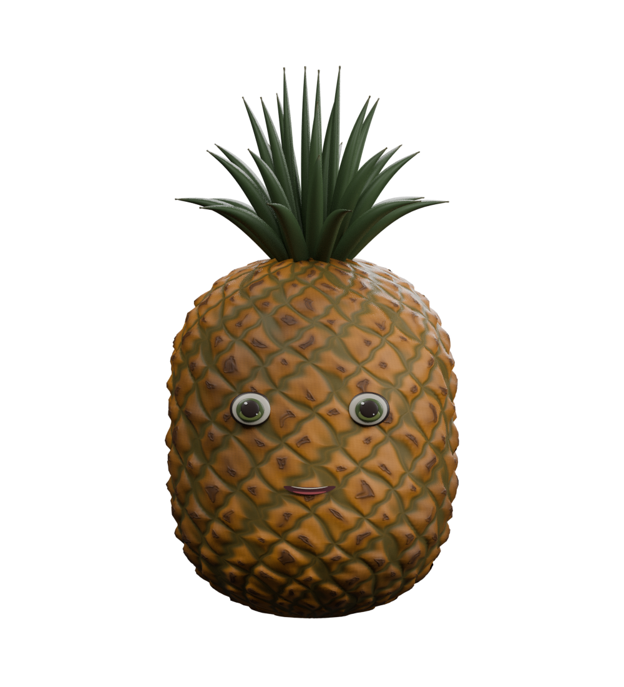
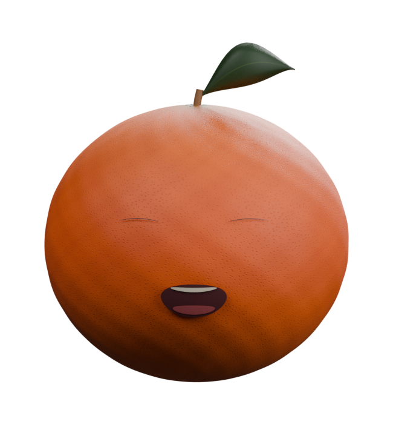
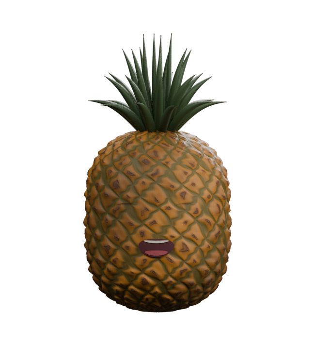

# Апельсин и ананас — аватары для VSeeFace, версия 3

Два фрукта с более натуральными материалами с лицами, без видимых рук и ног. Формат **VRM 0.0**.

| Апельсин | Ананас |
| --- | --- |
|  |  |
|  |  |

## Скачать

- [Обе модели и инструкция](VSeeFace-fruits.zip)
- [Полный комплект с исходниками Blender](Fruit-avatars.zip)
- Отдельно: [апельсин](models/orange.vrm), [ананас](models/pineapple.vrm).

На странице файла GitHub используйте кнопку скачивания **Download raw file**.

## Что изменено в версии 3

- Апельсин: слегка неровная, менее вытянутая форма; неоднородный оранжевый пигмент, мелкие масляные поры, зелёный оттенок у плодоножки, короткий черенок с чашелистиками.
- Ананас: золотисто-оливковые плодики с коричневыми центрами, рельефом и неровной окраской вместо чистой нарисованной сетки.
- Текстуры кожуры 1536×1536 и отдельные карты нормалей встроены в VRM. Карты нормалей подключены также в MToon.
- Более узкая натуральная листва: прожилки у цитрусового листа, продольная фактура и подсохшие кончики у короны ананаса.
- Глаза уменьшены, яркие декоративные блики, брови, румянец и веснушки убраны. Рот меньше, цвета радужек и ротовой полости приглушены.
- Сохранены 12 пресетов: Blink, Blink_L, Blink_R, A/I/U/E/O, Joy, Sorrow, Angry и Fun.

Это приближённые к реальности персонажи с анимируемыми лицами, а не фотограмметрические копии фруктов. Фотореализм не заявляется.

Рендеры Blender используют другое освещение: точное совпадение цвета, микрорельефа и теней в VSeeFace не гарантируется. Материал MToon настроен на более плавное затенение.

## Запуск в VSeeFace

1. Скачайте архив и распакуйте его на Windows-компьютере.
2. Нажмите **Add avatar**, выберите `orange.vrm` или `pineapple.vrm`.
3. Выберите камеру и микрофон, запустите отслеживание и калибровку.
4. Проверьте повороты головы, полное закрытие глаз и lip sync.
5. Для дополнительных эмоций настройте горячие клавиши VSeeFace.

Внутри — скрытый гуманоидный скелет в T-позе. Видимая геометрия привязана к голове. Движение взгляда отдельно от головы и физика листьев пока не реализованы.

**Импорт и трекинг в самом VSeeFace здесь не проверены:** среда работает на Linux. Структурные проверки и рендеры мимики не заменяют такую проверку. При ошибке импорта нужны её текст и версия VSeeFace.

## Исходники и сборка

`models/*.blend` — редактируемые исходники Blender 4.3.2 со встроенными текстурами, скелетом и shape keys. Скрипты создают модели, экспортируют glTF и добавляют структуру VRM 0.0.

Из существующего корня репозитория (отдельный worktree не нужен):

```sh
blender -b --factory-startup --python-exit-code 1 --python tools/build_models.py
python tools/validate_models.py
blender -b --factory-startup --python-exit-code 1 --python tools/render_expressions.py
python tools/package_models.py
```

Сборка перезаписывает файлы в `models/` и `previews/`. Сохраните ручные изменения перед повторным запуском. Расширения Blender не требуются.

Отчёты проверки контейнера glTF находятся в `validation/`. Общий glTF Validator не проверяет расширение VRM: для скелета, пресетов и встроенных текстур используется дополнительная проверка `tools/validate_models.py`.

Метаданные моделей: CC0, коммерческое использование разрешено.
