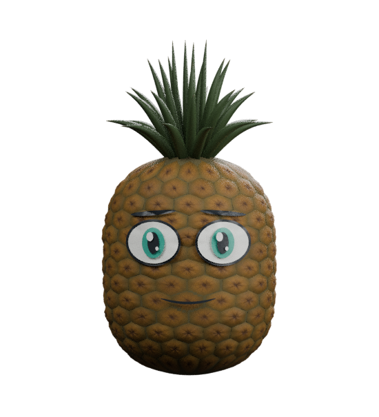
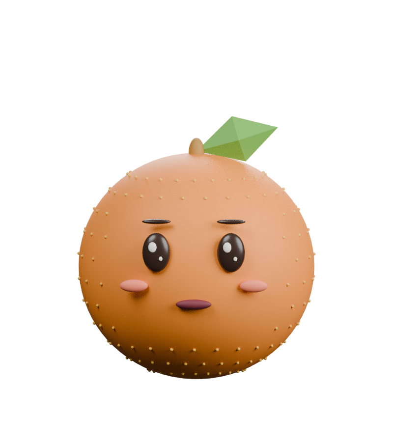
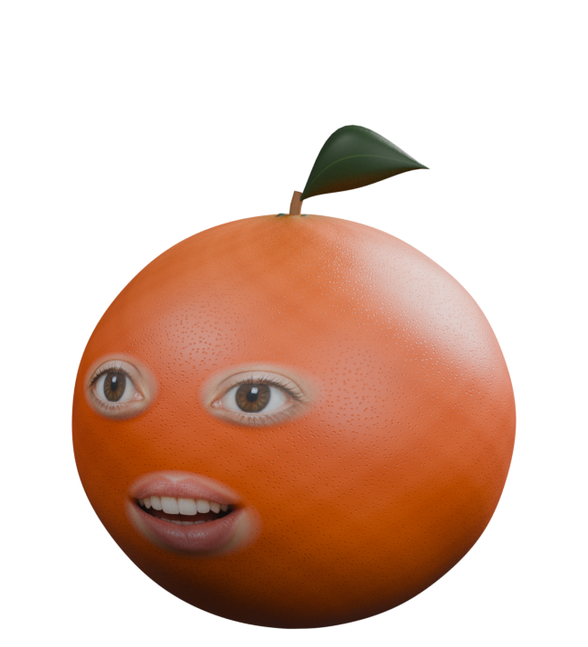
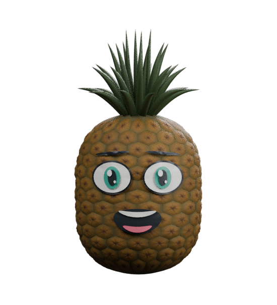

# Апельсин и ананас с человеческими лицами для VSeeFace

## Мультяшный ананас для VSeeFace — версия 6

**[Скачать ананас отдельно](Pineapple-VSeeFace.zip)** · **[Инструкция VSeeFace](VSeeFace-pineapple.md)**

У ананаса теперь мультяшное лицо: большие белые глаза с зелёными радужками, зрачками и бликами, брови, улыбка и открывающийся рот с зубами и языком. Лицо сделано геометрией без фотографических текстур. Сохранены моргание, пять форм рта, эмоции и четыре направления взгляда — всего 16 пресетов. Для обычного импорта VRM в VSeeFace Python не нужен.



## Живые глаза и рот с твоей камеры

Добавлен отдельный локальный режим: видео твоих настоящих глаз и рта накладывается на 3D-фрукт в реальном времени.

**[Скачать приложение с камерой](Live-fruits-camera.zip)** · **[Инструкция запуска и OBS](live-face/README.md)**

Распакуй архив, установи Python 3.10+ при необходимости, запусти `Запустить.bat`, затем нажми «Включить камеру» в Chrome/Edge. Все библиотеки входят в комплект; обработка лица локальная. Для OBS используется захват окна браузера с синим фоном и хромакеем. Это отдельное приложение, а не расширение VSeeFace.


Два отдельных аватара **VRM 0.0** для VSeeFace. Без видимых рук и ног.

| Апельсин | Ананас |
| --- | --- |
|  |  |
|  |  |

## Скачать

- [Обе модели и инструкция](VSeeFace-fruits.zip)
- [Полный комплект с Blender-исходниками, текстурами и скриптами](Fruit-avatars.zip)
- Отдельно: [апельсин](models/orange.vrm), [ананас](models/pineapple.vrm).

На странице файла GitHub нажмите **Download raw file**.

## Что изменено

- У апельсина фотореалистичные изображения человеческих глаз, век, губ и зубов наложены на деформируемые сетки с мягким переходом в кожуру. У ананаса — мультяшное лицо из непрозрачной геометрии с отдельными цветами белков, радужек, зрачков, бликов, зубов и языка.
- `assets/human_features.png` — сгенерированная текстура вымышленного лица, **не фотография реального человека**. Геометрия фруктов создана процедурно, фотограмметрические сканы в эти модели не включены.
- У ананаса отдельные объёмные чешуйки с неодинаковым рельефом. Под глазами и ртом поверхность сглажена; лицевая сетка проецируется на фактическую поверхность кожуры.
- Материалы используют физически основанную модель glTF PBR: цвет, нормали и шероховатость. В VRM 0 сохранён официальный режим `VRM_USE_GLTFSHADER` вместо MToon.
- Текстуры кожуры 2048×2048 встроены в `.vrm` и `.blend`. Фотографическая лицевая текстура используется только в VRM апельсина.
- У мультяшного ананаса при открывании рта меняется геометрия полости рта, зубов и языка; в покое видна закрытая улыбка.

## Мимика и ограничения

У апельсина 12 пресетов: Blink, Blink_L, Blink_R, A/I/U/E/O, Joy, Sorrow, Angry и Fun. У ананаса 16: дополнительно LookUp, LookDown, LookLeft и LookRight. Мимика апельсина деформирует текстурированные сетки; у ананаса деформируется мультяшная геометрия. Физика листьев не реализована. Взгляд ананаса зависит от поддержки этих пресетов источником отслеживания и настройками VSeeFace.

Рендеры Blender и освещение VSeeFace различаются. **Импорт, отображение прозрачных краёв лица и трекинг камерой в самом VSeeFace здесь не проверены**, поскольку среда работает на Linux. Проверки структуры файлов и рендеры не заменяют тест в приложении.

## Запуск в VSeeFace

1. Скачайте и распакуйте архив на Windows-компьютере.
2. Нажмите **Add avatar** и выберите нужный `.vrm`.
3. Выберите камеру и микрофон, запустите отслеживание и калибровку.
4. Проверьте повороты головы, полное закрытие глаз и lip sync.
5. Для дополнительных эмоций настройте горячие клавиши.

Если приложение сообщает об ошибке, сохраните её текст и версию VSeeFace.

## Исходники и сборка

Требуется Blender 4.3.2. Все исходные изображения лежат в `assets/`, внешних загрузок при сборке нет. Используйте существующий checkout; отдельный worktree не требуется.

```sh
blender -b --factory-startup --python-exit-code 1 --python tools/build_models.py
python tools/validate_models.py
blender -b --factory-startup --python-exit-code 1 --python tools/check_face_clearance.py
blender -b --factory-startup --python-exit-code 1 --python tools/render_expressions.py
blender -b --factory-startup --python-exit-code 1 --python tools/render_exported.py
python tools/package_models.py
```

Сборка перезаписывает `models/` и `previews/`. Сохраните ручные изменения перед повторным запуском. Для сборки одного фрукта добавьте `-- orange` или `-- pineapple` к команде Blender.

Результаты проверок находятся в `validation/`. Метаданные моделей: CC0, коммерческое использование разрешено.
